<div align="center">

# 🚀 Galactic Wars – Elite Fleet Evolution

**A neon arcade space shooter built in Scratch: 20 boss battles, 8 unique bosses, 6 ships, 7 power-ups and 3 game modes.**
**Play it on Windows, macOS, Linux, Android and iPhone/iPad — fully offline.**

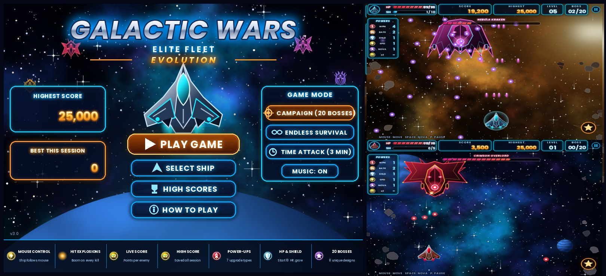

[**⬇️ Download for Windows / Mac / Linux**](../../releases/latest) &nbsp;•&nbsp;
[**📱 Play in the browser / on your phone**](#-play-on-mobile-android--iphone--ipad) &nbsp;•&nbsp;
[**🐱 Open in Scratch**](game/Galactic_Wars_Elite_Fleet.sb3)

</div>

---

## 📑 Contents
- [Screenshots](#-screenshots)
- [Install & play offline](#-install--play-offline) — [Windows](#-windows) · [macOS](#-macos) · [Linux](#-linux) · [Mobile](#-play-on-mobile-android--iphone--ipad) · [Any browser](#-any-computer-no-install) · [Scratch](#-in-scratch)
- [Controls](#-controls)
- [Game modes](#-game-modes)
- [How the game works](#-how-the-game-works) — levels, sectors, HP & shields, scoring
- [Ships](#-the-6-ships) · [Enemies](#-the-enemy-fleet) · [Bosses](#-the-8-bosses-20-boss-campaign) · [Power-ups](#-the-7-power-ups)
- [Animations & effects](#-animations--visual-effects) · [Sound](#-sound--music)
- [Parts of the game (screens & HUD)](#-parts-of-the-game)
- [Inside the Scratch project](#-inside-the-scratch-project)
- [Repository layout](#-repository-layout) · [Building & releasing](#-building--releasing)

---

## 📸 Screenshots

| Main menu | Ship select (hangar) |
|---|---|
| 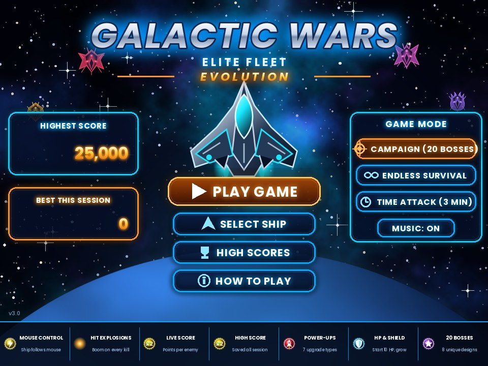 | 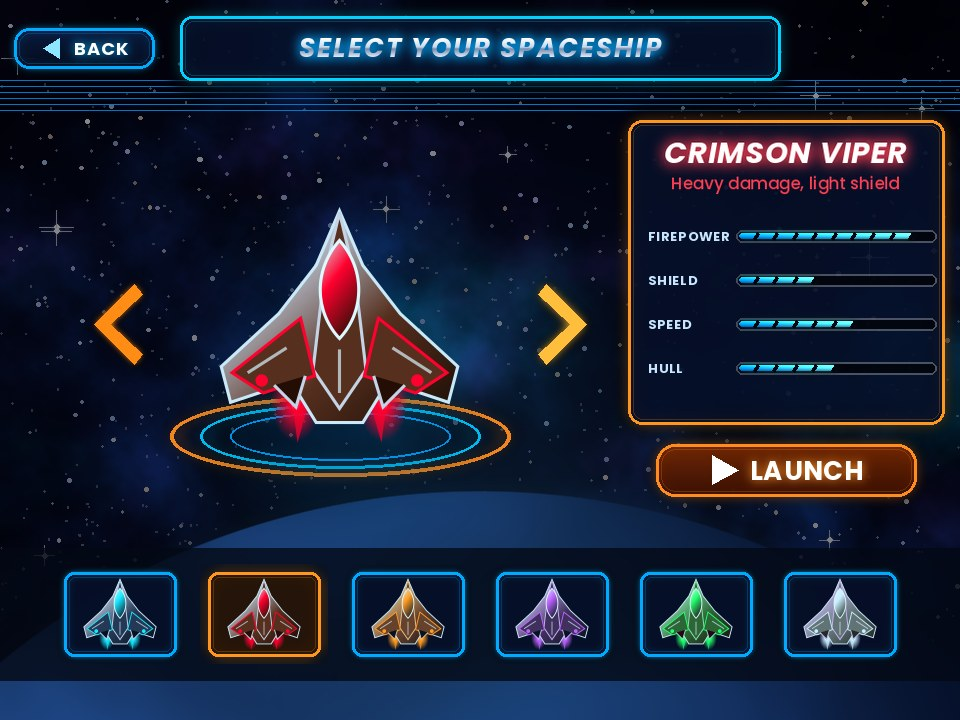 |
| **Gameplay** | **Boss battle – Nebula Kraken** |
| 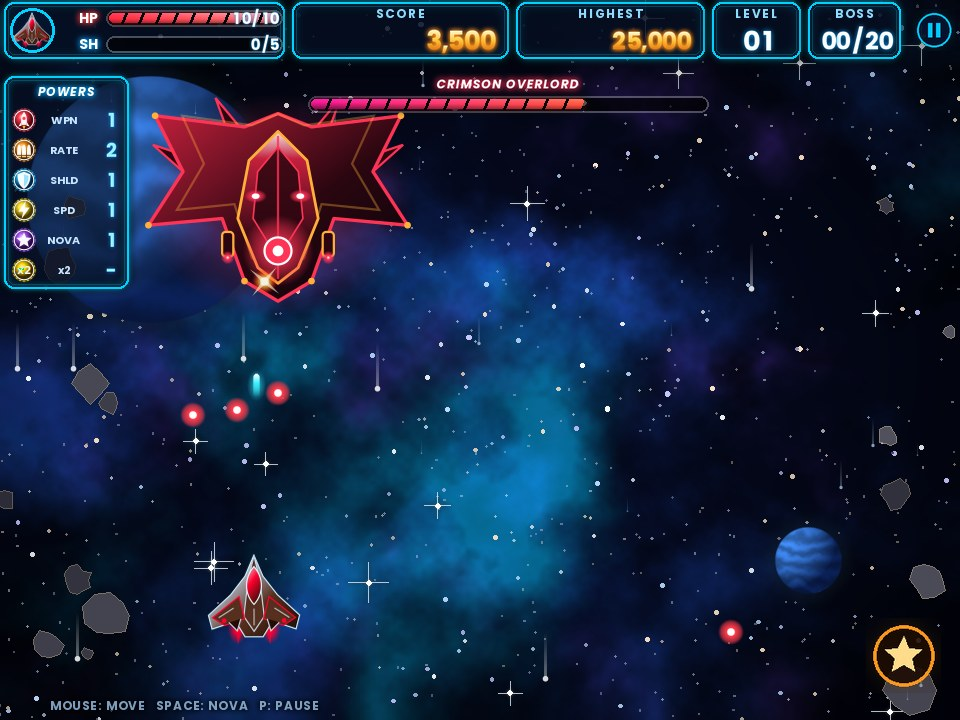 | 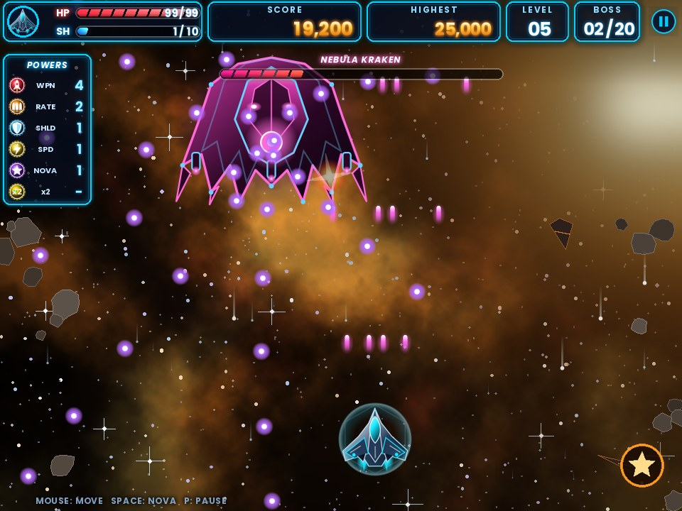 |
| **Boss battle – Solar Colossus** | **Boss battle – Titan Hivemind** |
| 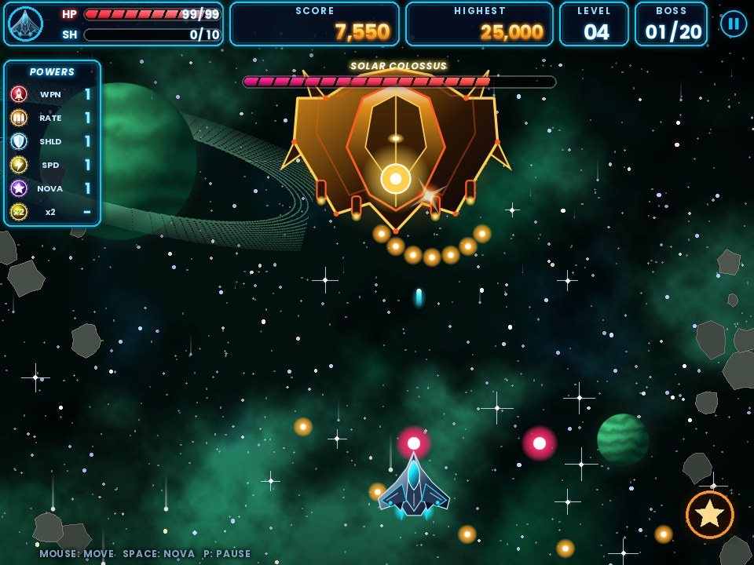 | 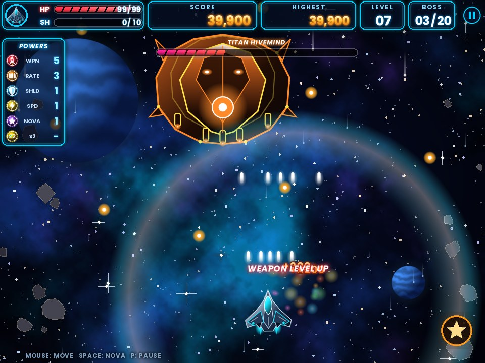 |
| **High scores** | **How to play** |
| 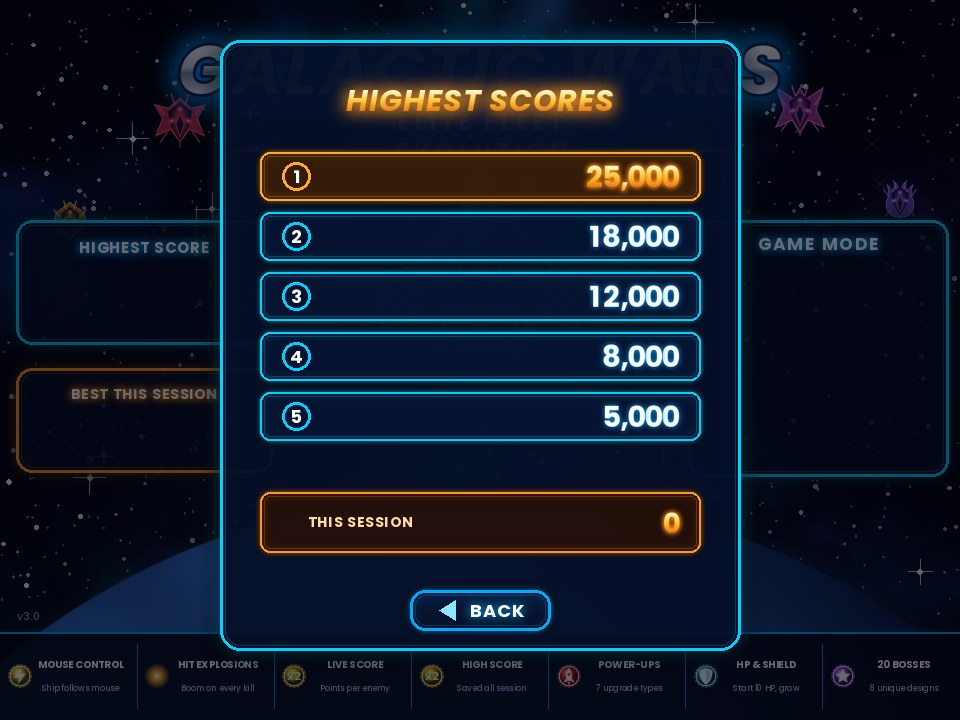 | 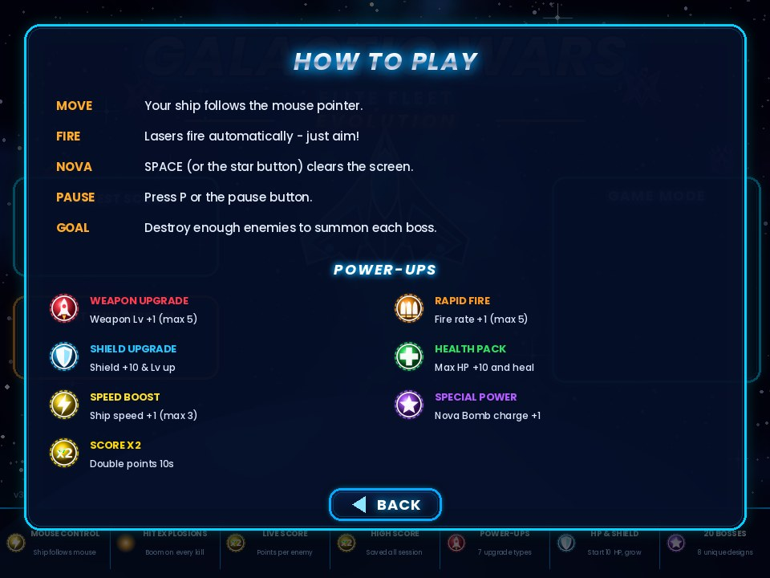 |
| **Paused** | **Game over** |
| 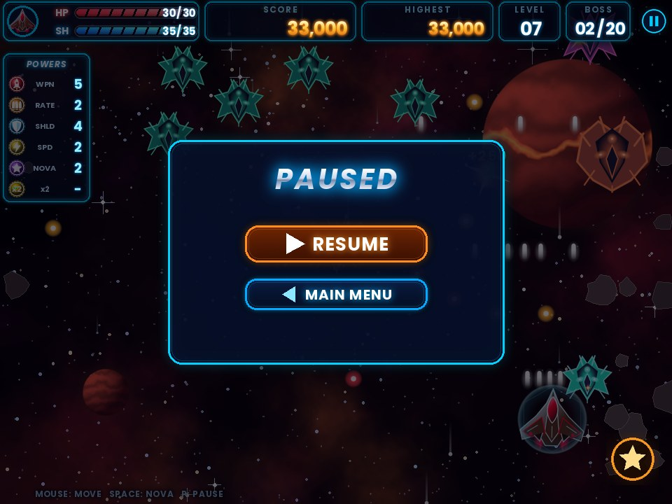 | 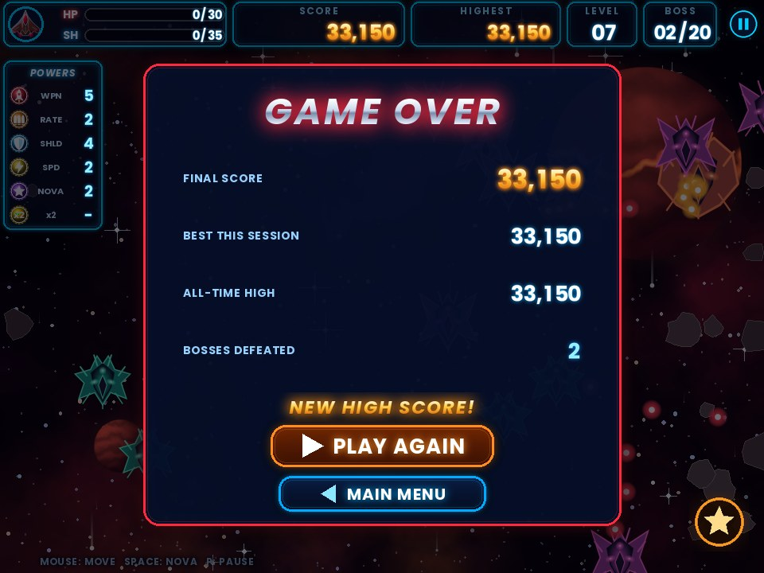 |

**On a phone** (touch controls — drag to fly, tap the ⭐ for a Nova Bomb):

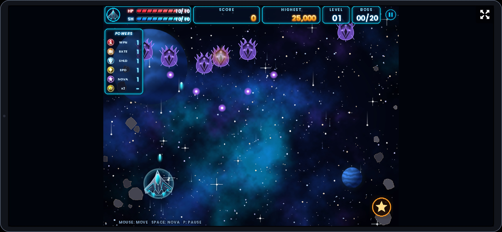

**As a desktop app** (Windows / Mac / Linux):

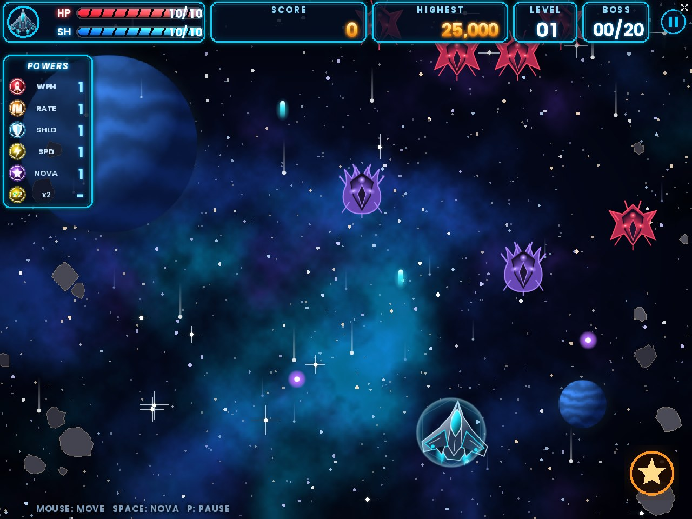

---

## 💾 Install & play offline

Every version below runs **without internet** once downloaded. Your best score is saved on your device.

### 🪟 Windows
1. Go to [**Releases**](../../releases/latest) and download **`Galactic-Wars-Setup-3.0.0.exe`**.
2. Run it → choose a folder → **Install**. A **Galactic Wars** shortcut is added to your Desktop and Start Menu.
3. Windows may show *"Windows protected your PC"* because the app isn't code-signed: click **More info → Run anyway**.

> Prefer no installation? Download `Galactic-Wars-3.0.0-Portable.exe` and just double-click it.
> Uninstall any time from **Settings → Apps → Galactic Wars**.

### 🍎 macOS
1. Download **`Galactic-Wars-3.0.0-mac.dmg`** from [Releases](../../releases/latest) (Universal: Apple Silicon M1–M4 and Intel).
2. Open it and drag **Galactic Wars** into **Applications**.
3. The first time, macOS blocks apps from unidentified developers:
   - **macOS 15 Sequoia+:** open the app once → **Done**, then **System Settings → Privacy & Security** → scroll down → **Open Anyway**.
   - **macOS 14 and earlier:** **Control-click** the app → **Open** → **Open**.
   - If macOS says the app is *damaged*, run once in Terminal: `xattr -cr "/Applications/Galactic Wars.app"`

### 🐧 Linux
Download `Galactic-Wars-3.0.0-linux-x86_64.AppImage`, then `chmod +x Galactic-Wars-*.AppImage` and run it.

### 📱 Play on mobile (Android / iPhone / iPad)
The game has a touch-friendly web version that installs like an app and **works offline**:

1. Open the game's web page on your phone: **`https://lois4801.github.io/galactic-wars/`**
   (published automatically from the `web/` folder by GitHub Pages — see [Building & releasing](#-building--releasing)).
2. Install it to your home screen:
   - **Android (Chrome):** menu **⋮ → Install app / Add to Home screen**
   - **iPhone / iPad (Safari):** **Share ⬆️ → Add to Home Screen**
3. Launch it from the home-screen icon. It opens full-screen, and after the first launch it **plays with no internet**.

**Touch controls:** turn the phone **sideways**, put your finger anywhere and **drag** – the ship follows your finger.
Tap the **⭐ button** (bottom-right) for a Nova Bomb and the **⏸ button** (top-right) to pause. All menus are tap-able.

### 💻 Any computer, no install
Download [`web/index.html`](web/index.html) (one 9 MB file) and double-click it — it opens in Chrome, Edge, Firefox or Safari and runs completely offline. You can also copy it to a phone or USB stick.

### 🐱 In Scratch
Open [scratch.mit.edu](https://scratch.mit.edu) (or the Scratch desktop app) → **File → Load from your computer** → choose [`game/Galactic_Wars_Elite_Fleet.sb3`](game/Galactic_Wars_Elite_Fleet.sb3) → click the green flag 🏁.

---

## 🎮 Controls

| Action | Computer | Phone / tablet |
|---|---|---|
| Fly the ship | Move the **mouse** — the ship glides to the pointer and tilts as it turns | **Drag** your finger |
| Shoot | **Automatic** — lasers fire constantly | Automatic |
| Nova Bomb | **Space** or click the **⭐** button | Tap **⭐** |
| Pause / resume | **P** or the **⏸** button | Tap **⏸** |
| Menus | Click buttons (they glow when hovered) | Tap buttons |
| Fullscreen | **F11** (desktop app) / fullscreen button (browser) | Install to home screen |

---

## 🕹️ Game modes

Pick a mode in the **GAME MODE** panel on the main menu.

| Mode | Goal | HUD "BOSS" box shows |
|---|---|---|
| 🎯 **Campaign (20 Bosses)** | Beat all 20 boss fights to win (**VICTORY!** screen) | Bosses beaten, e.g. `05/20` |
| ♾️ **Endless Survival** | Never ends — enemies and bosses keep getting stronger. Survive as long as you can | Bosses beaten |
| ⏱️ **Time Attack (3 min)** | Score as many points as possible in 3 minutes (**TIME UP!** screen) | Time left, e.g. `2:35` |

---

## 🧭 How the game works

### Levels, waves and sectors
- Every **level** starts with waves of enemies. Destroy enough of them (**22** on level 1, then **18 + 4 × level**) and a **⚠️ WARNING! BOSS APPROACHING** alarm sounds — the level's boss flies in.
- Defeat the boss → **BOSS DEFEATED!** banner, bonus points, 3 power-ups drop, your **shield is fully recharged**, and you warp to the next level.
- Each level moves you to a new **sector** with its own hand-painted background (they repeat in this order):

| # | Sector | Look |
|---|---|---|
| 1 | **Blue Nebula** | Deep-blue cloudscape with an ice-giant planet |
| 2 | **Crimson Rift** | Red nebula and a planet split by a glowing lava rift |
| 3 | **Emerald Expanse** | Green gas clouds and a ringed planet |
| 4 | **Violet Storm** | Purple storm clouds with lightning bolts |
| 5 | **Solar Graveyard** | A blazing sun and drifting starship wrecks |

- Difficulty ramps up each level: new enemy types unlock, enemies get more HP, spawn faster, and enemy bullets hit harder (every 7 levels).

### Health & shields
- You start with **10 HP** and a **shield** (amount depends on your ship). Both bars are always visible in the top-left of the HUD with exact numbers like `10/10`.
- **The shield absorbs damage first.** When it's empty, hits go to your HP. A blue bubble around your ship shows your shield is up and flashes when it's hit.
- After a hit you **blink** and are briefly **invulnerable**; a red screen-flash warns you when HP is hit.
- Every **Health Pack** raises your max HP by **+10** (up to 100) and heals you. Every **Shield** power-up raises max shield by **+10** and refills it.
- HP reaches 0 → your ship explodes → **GAME OVER**.

### Scoring & high scores
- Every enemy gives points (100–600). Bosses give **5,000 + 1,000 × level**. Maxed-out power-ups give **+1,000** bonus each.
- **Score ×2** power-up doubles everything for 10 seconds.
- Floating **"+150" style numbers** pop up wherever you score.
- Tracked scores:
  - **Score** — this run (top HUD)
  - **Highest** — all-time best, updates live when you beat it, and shows **NEW HIGH SCORE!** on the results screen
  - **Best This Session** — your best since the game was opened (main menu, high-score and game-over screens)
  - **Top 5 table** — the **HIGH SCORES** screen
- In the desktop app and web/mobile version the all-time high score is **saved on your device** (it survives closing the game). On scratch.mit.edu it's a ☁ cloud variable.

---

## ✈️ The 6 ships

Choose your ship in **SELECT SHIP** using the arrows or by clicking a thumbnail. The panel shows its name, speciality and stat bars.

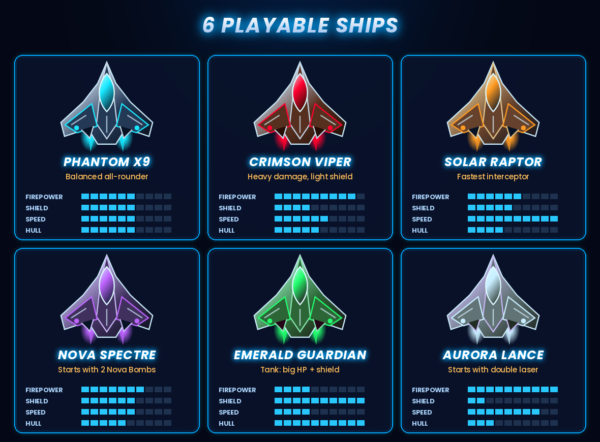

| Ship | Special | Damage | Speed | Shield | HP |
|---|---|---|---|---|---|
| **Phantom X9** | Balanced all-rounder | 1.0× | 1.0× | 10 | 10 |
| **Crimson Viper** | Heavy damage, light shield | 1.4× | 1.0× | 5 | 10 |
| **Solar Raptor** | Fastest interceptor | 1.0× | 1.35× | 5 | 10 |
| **Nova Spectre** | Starts with **2 Nova Bombs** | 1.2× | 1.0× | 10 | 10 |
| **Emerald Guardian** | Tank — big HP & shield, slower | 0.85× | 0.85× | 20 | 15 |
| **Aurora Lance** | Starts with **double laser**, no shield | 1.25× | 1.15× | 0 | 10 |

---

## 👾 The enemy fleet

7 enemy types, each with its own movement and attack. New types unlock as you level up.

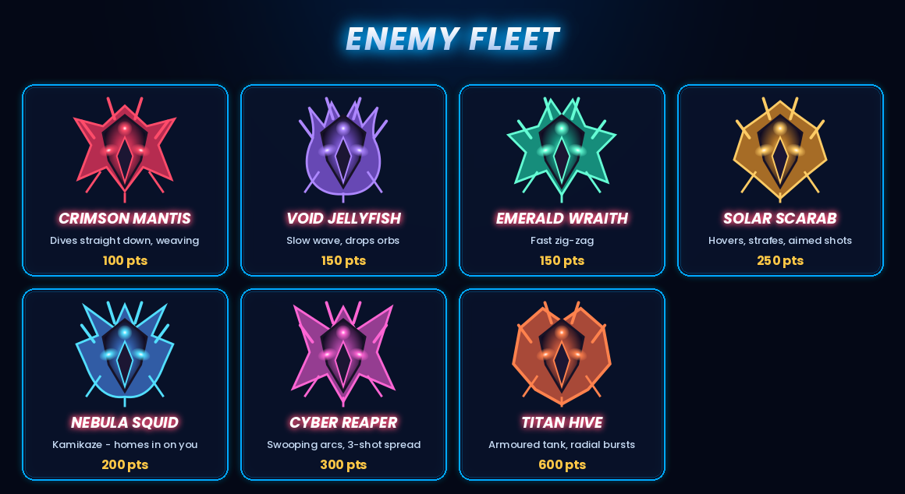

| Enemy | Behaviour | Points |
|---|---|---|
| **Crimson Mantis** | Dives straight at you, weaving side to side | 100 |
| **Void Jellyfish** | Drifts in a slow wave and drops plasma orbs | 150 |
| **Emerald Wraith** | Fast zig-zag that bounces off the screen edges | 150 |
| **Solar Scarab** | Flies in, hovers, strafes and fires **aimed shots** at you, then leaves | 250 |
| **Nebula Squid** | **Kamikaze** — homes in on your position | 200 |
| **Cyber Reaper** | Swoops in wide arcs and fires a **3-shot spread** | 300 |
| **Titan Hive** | Heavily armoured tank; fires **8-way radial bursts**; often drops power-ups | 600 |

Enemies arrive alone or in **V-formations** of 3–6. Ramming an enemy hurts you (and destroys it).

---

## 👹 The 8 bosses (20-boss campaign)

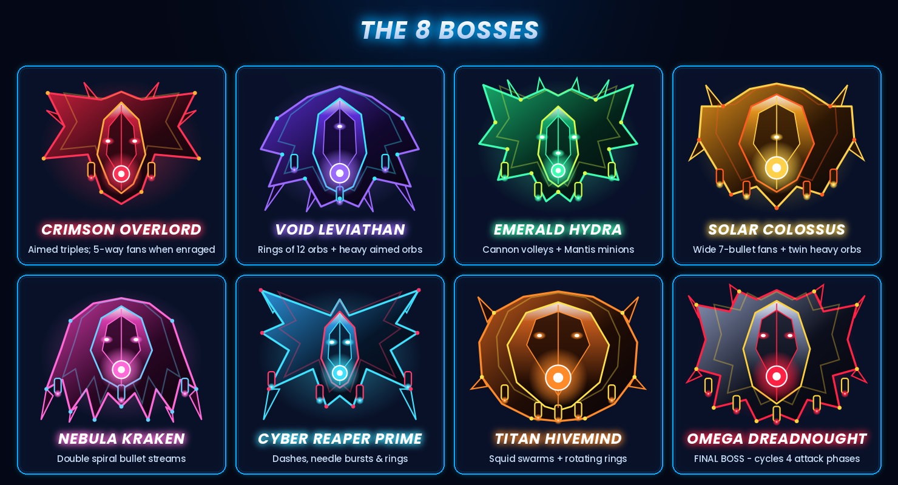

| # | Boss | Movement | Attack pattern |
|---|---|---|---|
| 1 | **Crimson Overlord** | Wide side-to-side sweep | Aimed 3-shot fans; adds 5-way fans when enraged |
| 2 | **Void Leviathan** | Slow figure-eight | Rotating **rings of 12 orbs** + heavy aimed orbs |
| 3 | **Emerald Hydra** | Quick sway | Four-cannon volleys; **summons Crimson Mantis minions** |
| 4 | **Solar Colossus** | Huge slow sweep | Wide **7-bullet fans** + twin heavy orbs |
| 5 | **Nebula Kraken** | Circling drift | **Double spiral** bullet streams (bullet-hell!) |
| 6 | **Cyber Reaper Prime** | **Teleport-style dashes** | Bursts of aimed needles; needle rings when enraged |
| 7 | **Titan Hivemind** | Slow patrol | **Summons Nebula Squid swarms** + rotating 8-way rings |
| 8 | **Omega Dreadnought** | Aggressive sweep | **Final boss:** cycles 4 phases — aimed fans, 16-orb rings, 9-bullet fans + Reaper minions, and twin needle spirals |

How bosses work:
- **20 boss fights:** levels 1–8 use bosses 1–8, levels 9–16 bring them back as **recoloured Mk II versions** (new colours, more HP), then 17–19, and **level 20 is always the giant Omega Dreadnought**.
- Boss HP = **80 + 45 × level** (the final boss has 1.7× HP and is drawn larger). A **boss health bar with the boss's name** appears under the HUD.
- **Enrage:** below 50 % HP every boss attacks about **50 % faster**.
- Bosses flash white when hit, explode in a chain of 9 explosions with a screen flash, and drop **3 power-ups** (always a Weapon Upgrade and a Health Pack).

---

## ⚡ The 7 power-ups

Power-ups drop from destroyed enemies (15 %; Titan Hives 65 %) and bosses. They float down, wobble, pulse, and are **pulled toward your ship** when you get close (magnet). They blink before disappearing. When you grab one, a pickup ring flashes and its name pops up above your ship. Your current levels are listed in the **POWERS** panel on the left of the HUD.

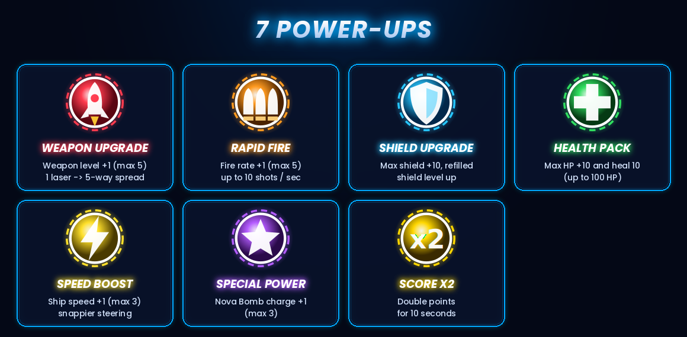

| Power-up | Effect | Max |
|---|---|---|
| 🚀 **Weapon Upgrade** | Weapon level +1. Lv1 single laser → Lv2 twin → Lv3 triple spread → Lv4 quad → Lv5 5-way spread. Laser colour changes with level | Lv 5 |
| 🔫 **Rapid Fire** | Fire rate +1 (from about 3 to 10 shots per second) | Lv 5 |
| 🛡️ **Shield Upgrade** | Max shield +10, shield fully refilled, shield level +1 | 100 shield |
| ➕ **Health Pack** | Max HP +10 and heals 10 HP. Drops more often when your HP is low | 100 HP |
| ⚡ **Speed Boost** | Ship follows the mouse/finger faster | Lv 3 |
| ⭐ **Special Power (Nova Bomb)** | +1 Nova Bomb charge. Press **Space** / tap ⭐ to destroy every normal enemy, erase all enemy bullets and deal 12 % damage to a boss | 3 charges |
| ✖️2 **Score ×2** | Double points for 10 seconds (countdown shown in the POWERS panel) | — |

If a power-up is already maxed you get **+1,000 points** instead.

---

## ✨ Animations & visual effects

- **Smooth ship flight** — the ship eases toward the pointer and **banks/tilts** left and right as it turns; glowing engine trails.
- **Parallax starfield** — 24 stars on 3 depth layers stream past to create a sense of speed over the painted sector backgrounds.
- **Explosions** — every kill plays a 6-frame fireball flash plus 6–12 glowing debris particles that fly out, slow down and fade. Big enemies and bosses also create an expanding shock-ring.
- **Hit sparks & hit flash** — bullets spark on impact; enemies and bosses flash white when hit.
- **Score popups** — floating "+points" numbers rise and fade where you scored.
- **Shield bubble** — pulsing hex-shield around your ship that brightens when it absorbs a hit.
- **Damage feedback** — red screen flash and ship blinking during invulnerability.
- **Boss entrance & death** — bosses glide in from the top, hover and weave; on death a chain of explosions and a full-screen white flash.
- **Nova Bomb** — expanding purple shockwave from your ship plus a screen flash.
- **Banners** — animated fade/zoom banners for *SECTOR 1 – BLUE NEBULA*, *WARNING! BOSS APPROACHING*, *BOSS DEFEATED!*, *NOVA BLAST!*.
- **Power-up animations** — bobbing, pulsing size, magnet pull, blink-out, pickup ring and floating power-up name.
- **Animated UI** — buttons glow on hover, the selected game mode is highlighted orange, the hangar ship bobs on its platform, ship thumbnails grow on hover, the *NEW HIGH SCORE!* badge pulses.
- **Enemy bullet types** — red and purple plasma orbs, green and orange orbs, large heavy orbs, and needles that point along their flight direction.

## 🔊 Sound & music
Synthwave battle-theme music loop (toggle with **MUSIC: ON/OFF** on the menu), plus sound effects for lasers, hits, explosions, big boss explosions, power-up pickups, shield hits, damage, boss warning siren, Nova Bomb, level-up, victory, game over and button clicks.

---

## 🧩 Parts of the game

**Screens**
1. **Main menu (title screen)** — cinematic title art, Play / Select Ship / High Scores / How to Play, Game Mode panel, Music toggle, Highest Score and Best This Session panels, feature strip.
2. **Select Ship (hangar)** — bobbing ship preview on a glowing platform, name & speciality, 4 stat bars, 6 thumbnails, arrows, **LAUNCH**.
3. **High Scores** — top-5 table + best this session.
4. **How to Play** — controls and all 7 power-ups explained.
5. **Battle** — the game itself (see HUD below).
6. **Paused** — Resume or Main Menu (the action freezes behind it).
7. **Game Over / Victory / Time Up** — final score, best this session, all-time high, bosses defeated, *NEW HIGH SCORE!* badge, **Play Again** or **Main Menu**.

**The battle HUD**
- **Top-left:** ship icon, **HP bar** (red) and **Shield bar** (blue) with numbers.
- **Top:** **SCORE**, **HIGHEST**, **LEVEL**, **BOSS** (or the timer in Time Attack), and the **⏸ pause button**.
- **Left:** **POWERS** panel — Weapon, Rate, Shield and Speed levels, Nova charges and the ×2 timer.
- **Under the top bar (boss fights):** boss name and boss health bar.
- **Bottom-right:** **⭐ Nova Bomb button**. **Bottom-left:** control hints.

---

## 🧠 Inside the Scratch project

The `.sb3` file is the full, editable source of the game (open it in Scratch to look inside or remix it). It contains 30 sprites and about 5,000 blocks:

| Group | Sprites |
|---|---|
| Gameplay | `Player`, `Player Bullet`, `Enemy`, `Enemy Bullet`, `Boss`, `Powerup`, `Shield FX` |
| Effects | `FX` (explosions/particles/rings), `Popup` (score numbers), `Stars`, `Banner`, `PU Text`, `Hurt Flash`, `White Flash` |
| HUD | `HUD`, `HP Bar`, `Shield Bar`, `Boss Bar`, `Boss Name`, `HUD Ship`, `Digits` (all on-screen numbers) |
| Menus | `Thumbnail` (cinematic title screen), `Buttons`, `Panel`, `Ship Preview`, `Ship Name`, `Stat Bars`, `Ship Thumbs`, `New High` |
| Stage | 5 sector backdrops + hangar; the game "director" (levels, bosses, timer, scores, screens) |

Key design notes for remixers:
- Uses **clones** for bullets, enemies, particles and UI, staying under Scratch's 300-clone limit (peaks below 200 in testing).
- Player-bullet collisions use shared lists (`BX`, `BY`, `BA`, `BD`) so hit detection is fast and exact; spawn requests travel through queue lists (`EQ`, `FXQ`, `PQ`, `PUQ`, `MQ`).
- Important variables: `HP`, `Max HP`, `Shield`, `Max Shield`, `Weapon Level`, `Fire Level`, `Speed Level`, `Nova`, `Score`, `Highest Score`, `Best This Session`, `Level`, `Bosses Defeated`, `Mode`, `Screen`.
- Tested in the real Scratch engine: a 200-second automated run beat 14 bosses with 0 errors, and every menu path, mode, pause, Nova, victory and game-over path was checked.

---

## 🗂️ Repository layout

```
galactic-wars/
├── game/Galactic_Wars_Elite_Fleet.sb3   ← the Scratch project (source of the game)
├── web/                                 ← offline web + mobile (PWA) version → GitHub Pages
│   ├── index.html                       ← whole game in one file (works offline)
│   ├── manifest.webmanifest, sw.js      ← "install to home screen" + offline cache
│   └── icon-*.png
├── desktop/                             ← Windows / macOS / Linux app (Electron)
│   ├── main.js                          ← app window (F11 fullscreen, offline)
│   ├── package.json                     ← installer settings (electron-builder)
│   └── build/icon.png
├── tools/package-web/                   ← rebuilds web/index.html from the .sb3
├── docs/                                ← screenshots and galleries used in this README
└── .github/workflows/
    ├── build-installers.yml             ← builds .exe / .dmg / .AppImage on every Release
    └── deploy-web.yml                   ← publishes web/ to GitHub Pages
```

---

## 🛠️ Building & releasing

**1. Turn on the mobile/web version (once):** in this repo go to **Settings → Pages → Build and deployment → Source: GitHub Actions**. Every push to `main` then publishes `web/` to `https://lois4801.github.io/galactic-wars/`.

**2. Make installers:** go to **Releases → Draft a new release**, create a tag such as `v3.0.0`, and **Publish**. The *Build desktop installers* workflow builds on real Windows, macOS and Linux machines and attaches to the release:
- `Galactic-Wars-Setup-3.0.0.exe` (Windows installer) and `Galactic-Wars-3.0.0-Portable.exe`
- `Galactic-Wars-3.0.0-mac.dmg` and `Galactic-Wars-3.0.0-mac-universal.zip`
- `Galactic-Wars-3.0.0-linux-x86_64.AppImage`

(You can also run it from the **Actions** tab → *Build desktop installers* → **Run workflow**; files then appear under *Artifacts*.)

**3. After editing the game in Scratch:** save over `game/Galactic_Wars_Elite_Fleet.sb3`, then rebuild the web version and commit:
```bash
cd tools/package-web
npm install
npm run build          # writes ../../web/index.html
```
Bump `"version"` in `desktop/package.json` and publish a new release to get new installers.

**Run the desktop app from source:**
```bash
mkdir -p desktop/game && cp web/index.html desktop/game/
cd desktop && npm install && npm start
```

---

<div align="center">

Made with Scratch 🐱 · Packaged with TurboWarp Packager & Electron · Have fun, pilot! 🚀

</div>
